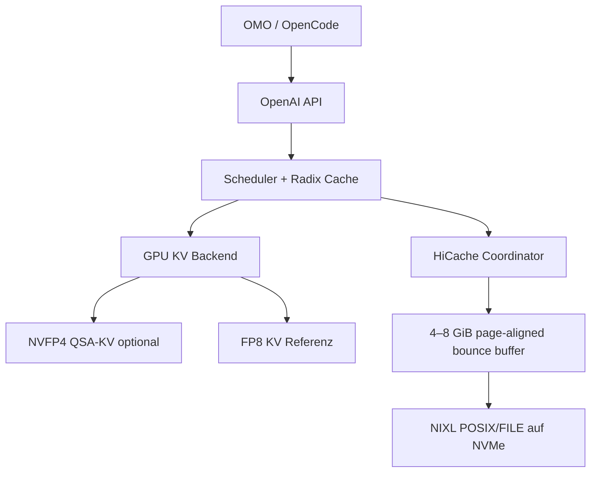

# Zielarchitektur Variante B



## Layer und Eigentümer

1. **Model layer**: NVIDIA ModelOpt/QAD-Loader. Eigentümer von Weight-/PLE-/MTP-Format.
2. **Overlay layer**: erzeugt nur einen neuen, manifestierten Hybrid-Checkpoint; niemals inplace.
3. **KV layer**: `KVBackend`-Interface mit FP8 und NVFP4-Implementierung. Nur dieser Layer kennt Packed-E2M1 und Scale-Sidecars.
4. **Cache layer**: verwaltet vollständige Zustandsgruppen: target KV, draft KV, scales, QSA index, Mamba/GDN state, metadata.
5. **Scheduler**: Admission C1/C2/C4/C6/C8; keine Formatlogik.
6. **Deployment**: pinned commits, Container, Rollback.

## KVBackend-Vertrag

```python
class KVBackend(Protocol):
    def allocate(self, tokens, layout) -> Handle: ...
    def write(self, handle, k, v, scales, stream) -> None: ...
    def gather(self, handle, positions, mode) -> GatheredKV: ...
    def dequantize(self, gathered, dtype, stream) -> TensorPair: ...
    def evict(self, handle) -> StorageManifest: ...
    def restore(self, manifest, destination, stream) -> None: ...
    def validate(self, handle, checksum_mode) -> ValidationResult: ...
```

## Basispfad

Phase 1 nutzt Pennyroyal + FP8-KV + native NEXTN. Phase 2 aktiviert NVFP4-KV nur hinter einem Feature-Flag. Phase 3 importiert einzelne Hyperburst-Kernel-/Graph-Patches. Phase 4 implementiert Streaming-Restore. Erst danach werden C4/C8-Profile optimiert.

## Overlay-Entscheidung

Das Overlay wird nur angewendet, wenn Tensorname, Shape, Quantisierung, Scale-Layout, Architekturrevision und Loaderpfad identisch sind. Andernfalls bleibt NVIDIA unverändert und der Blocker wird dokumentiert.
